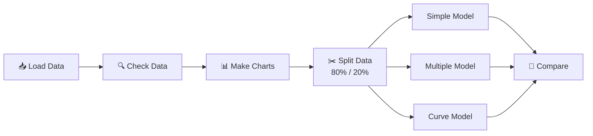

<div align="center">

# 🏡 House Price Predictor

### Guess the price of a house using Machine Learning


[About](#-about) •
[Data](#-data) •
[Steps](#-steps) •
[Results](#-results) •
[How to Run](#-how-to-run) •
[Next Steps](#-next-steps)

</div>

---

## 📌 About

This project guesses the **price of a house** (in INR) using details like size, rooms, location and age.

The notebook does these things:

- Looks at the data and draws charts
- Builds **3 different models**
- Compares them to find the best one

> **Best result:** The model that uses **all 10 details** is right about **91.8%** of the time. The model that uses **only the house size** is right about **56.3%** of the time.

---

## 📂 Files

```
📦 House-Price-Predictor
 ┣ 📓 Predictive_Insight_Engine.ipynb      ← Main notebook
 ┣ 📊 RealEstate_HousePrice_Dataset.csv    ← Data of 4,200 houses
 ┗ 📝 README.md                            ← This file
```

---

## 🗃️ Data

| | |
|---|---|
| **Number of houses** | 4,200 |
| **Number of columns** | 12 |
| **Missing values** | None ✅ |
| **Repeated rows** | None ✅ |
| **What we predict** | `house_price_inr` |

### Columns

| Column | Meaning |
|---|---|
| `area_sqft` | Size of the house (sq. ft.) |
| `bedrooms` | Number of bedrooms |
| `bathrooms` | Number of bathrooms |
| `location_score` | How good the area is (0 to 10) |
| `age_years` | How old the house is |
| `distance_city_km` | Distance from the city centre (km) |
| `lot_size_sqft` | Size of the land (sq. ft.) |
| `has_garage` | 1 = has garage, 0 = no garage |
| `has_pool` | 1 = has pool, 0 = no pool |
| `renovation_years_ago` | Years since last repair or upgrade |
| `house_id` | House number *(not used for the model)* |
| **`house_price_inr`** | **Price of the house (what we predict)** |

### 🔗 What affects the price most?

A higher bar means a stronger link with price.

```
area_sqft             ████████████████████░  +0.76
bedrooms              █████████████████░░░░  +0.64
location_score        ███████████████░░░░░░  +0.59
lot_size_sqft         ███████████████░░░░░░  +0.57
bathrooms             ██████████████░░░░░░░  +0.53
distance_city_km      ████████████░░░░░░░░░  -0.47  (far from city = cheaper)
has_garage            █████░░░░░░░░░░░░░░░░  +0.18
has_pool              ███░░░░░░░░░░░░░░░░░░  +0.10
age_years             ██░░░░░░░░░░░░░░░░░░░  -0.09
renovation_years_ago  █░░░░░░░░░░░░░░░░░░░░  -0.04
```

---

## 🔄 Steps



| Step | What we do |
|---|---|
| **1. Load** | Read the CSV file |
| **2. Check** | Look for missing or repeated data |
| **3. Charts** | Draw size vs. price, bedrooms vs. price and a heatmap |
| **4. Split** | 80% to teach the model (3,360 houses), 20% to test it (840 houses) |
| **5. Build** | Make 3 models (see below) |
| **6. Compare** | Check which model makes the smallest mistakes |

### The 3 Models

| Model | Simple meaning |
|---|---|
| **Simple Linear** | Uses only house size to guess the price |
| **Multiple Linear** | Uses all 10 details to guess the price |
| **Polynomial (Curve)** | Uses house size, but allows a curved line |

---

## 🏆 Results

Tested on 840 houses that the model had **never seen** before.

| Model | Details Used | Average Mistake (₹) | Score (R²) |
|---|:---:|---:|:---:|
| Simple Linear | 1 | 62,94,594 | 0.563 |
| Polynomial (Curve) | 1 | 62,92,395 | 0.563 |
| 🥇 **Multiple Linear** | **10** | **26,04,991** | **0.918** |

> **Score (R²):** closer to 1 is better. 1 means a perfect guess.

### 📉 Average Mistake

```
Simple    ████████████████████████████████████████  ₹62.9 lakh
Multiple  ████████████████░░░░░░░░░░░░░░░░░░░░░░░░  ₹26.0 lakh   (59% smaller)
```

### 💡 What we learned

1. **Size alone is not enough.** Using all details makes the mistake **59% smaller**.
2. **Price grows in a straight line with size.** The curve model gave no real gain.
3. **No overfitting.** The model works just as well on new houses as on the ones it learned from.
4. **Cost per sq. ft.** Each extra square foot adds about **₹14,788** to the price.

---

## 🚀 How to Run

### 1. Download the project

```bash
git clone https://github.com/<your-username>/House-Price-Predictor.git
cd House-Price-Predictor
```

### 2. Install the tools

```bash
pip install numpy pandas matplotlib seaborn scikit-learn jupyter
```

### 3. Open the notebook

```bash
jupyter notebook Predictive_Insight_Engine.ipynb
```

> 📌 Keep the CSV file in the same folder as the notebook. Then run all cells from top to bottom.

### 🔮 Try your own house

```python
import pandas as pd
from sklearn.model_selection import train_test_split
from sklearn.linear_model import LinearRegression

df = pd.read_csv("RealEstate_HousePrice_Dataset.csv")
X = df.drop(columns=["house_id", "house_price_inr"])
y = df["house_price_inr"]

X_train, X_test, y_train, y_test = train_test_split(X, y, test_size=0.20, random_state=42)
model = LinearRegression().fit(X_train, y_train)

new_house = pd.DataFrame([{
    "area_sqft": 2000, "bedrooms": 4, "bathrooms": 3, "location_score": 7.5,
    "age_years": 10, "distance_city_km": 12.0, "lot_size_sqft": 4500,
    "has_garage": 1, "has_pool": 0, "renovation_years_ago": 5,
}])

print(f"Guessed price: ₹{model.predict(new_house)[0]:,.0f}")
```

---

## 🛠️ Tools Used

| Use | Tool |
|---|---|
| Handle data | `pandas`, `numpy` |
| Draw charts | `matplotlib`, `seaborn` |
| Build models | `scikit-learn` |
| Run code | Jupyter Notebook |

---

## 🗺️ Next Steps

- [x] Look at the data
- [x] Build 3 models and compare them
- [x] Check for overfitting
- [ ] Try more models (Ridge, Lasso, Random Forest)
- [ ] Test the model in more than one way (cross-validation)
- [ ] Save the best model to use later
- [ ] Make a small web app (Streamlit or Flask)

---

## 👤 Author

**Your Name**
GitHub: [@your-username](https://github.com/your-username) • LinkedIn: [your-profile](https://linkedin.com/in/your-profile)

---

<div align="center">

⭐ Like this project? Give it a star!

</div>
