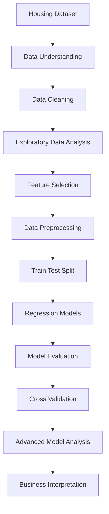

<div align="center">

# 🏡 HOUSE PRICE PREDICTION
### Advanced Regression | Machine Learning Project

**Turning Real Estate Data into Smart Price Predictions**

<br>


</div>

---

# 📌 1. Project Introduction

House price prediction is an important real-world application of Machine Learning.

This project focuses on developing and evaluating multiple regression models to predict residential property prices based on different property characteristics.

Using Python and Scikit-learn, I performed data preprocessing, exploratory data analysis, feature selection, model training, performance evaluation, and cross-validation.

The project also explores advanced concepts such as **Regularization, Gradient Descent, Overfitting, Underfitting, and Bias–Variance Trade-Off.**

### 🎯 Main Goal

To identify a suitable regression model that can accurately estimate house prices and provide meaningful insights for real estate decision-making.

---

# 📑 2. Table of Contents

1. Project Overview
2. Dataset Information
3. Technologies & Libraries
4. Project Workflow
5. Data Preprocessing
6. Regression Algorithms
7. Model Evaluation
8. Cross-Validation
9. Overfitting & Underfitting
10. Gradient Descent
11. Bias–Variance Analysis
12. Business Insights
13. Key Learnings
14. Future Improvements
15. Author

---

# 📊 3. Dataset Information

**Dataset:** `Advanced_Regression_HousePrice.csv.csv`

| Dataset Details | Information |
|---|---|
| Total Records | 3,800 |
| Total Features | 11 |
| Total Columns | 12 |
| Target Variable | `house_price_inr` |
| Problem Type | Supervised Learning |
| ML Technique | Regression |

### 🔍 Features Description

| Feature | Description |
|---|---|
| property_id | Unique property ID |
| sale_date | Property sale date |
| area_sqft | Property area |
| bedrooms | Number of bedrooms |
| bathrooms | Number of bathrooms |
| location_score | Location quality |
| property_age | Property age |
| distance_city_km | Distance from city |
| near_school | School availability |
| near_metro | Metro availability |
| crime_rate_index | Crime rate indicator |
| house_price_inr | Target house price |

---

# 🛠️ 4. Technologies & Libraries

| Technology | Application |
|---|---|
| Python | Core programming |
| Pandas | Data manipulation |
| NumPy | Numerical operations |
| Matplotlib | Data visualization |
| Seaborn | Statistical visualization |
| Scikit-learn | Regression and evaluation |
| Jupyter Notebook | Development environment |

---

# 🔄 5. Project Workflow



---

# 🧹 6. Data Preprocessing

The following preprocessing activities are included in the project:

- Dataset loading and inspection.
- Checking missing values.
- Handling missing values using median imputation.
- Separating independent and dependent variables.
- Removing unnecessary identifier and date columns from model features.
- Splitting data into training and testing sets.
- Applying feature scaling.
- Building preprocessing pipelines.

### 📌 Train-Test Split

| Dataset | Records | Percentage |
|---|---:|---:|
| Training Data | 3,040 | 80% |
| Testing Data | 760 | 20% |

---

# 🤖 7. Regression Algorithms

Seven regression approaches were implemented and compared.

| No. | Algorithm | Purpose |
|---|---|---|
| 1 | Linear Regression | Basic linear relationship |
| 2 | Ridge Regression | L2 regularization |
| 3 | Lasso Regression | L1 regularization |
| 4 | Decision Tree Regressor | Non-linear relationships |
| 5 | Random Forest Regressor | Ensemble learning |
| 6 | Linear SVR | Support Vector Regression |
| 7 | RBF SVR | Non-linear SVR |

---

# 📈 8. Model Performance Comparison

The following table presents the current training and testing R² results.

| Model | Training R² | Testing R² |
|---|---:|---:|
| Linear Regression | 91.62% | 91.87% |
| Ridge Regression | 91.62% | 91.87% |
| Lasso Regression | 91.62% | 91.87% |
| Decision Tree | 89.94% | 88.35% |
| Random Forest | 98.93% | **92.75%** |
| Linear SVR | -0.58% | -0.19% |
| RBF SVR | -0.36% | 0.01% |

### 🏆 Best Model: Random Forest Regressor

Random Forest achieved the highest testing R² score of approximately **92.75%** among the evaluated models.

However, its training score is higher than its testing score. This indicates a possible generalization gap that requires further investigation.

---

# 📐 9. Model Evaluation Metrics

To evaluate prediction performance, the following metrics are used:

| Metric | Meaning |
|---|---|
| MAE | Average absolute prediction error |
| MSE | Average squared prediction error |
| RMSE | Square root of MSE |
| R² Score | Explained variance in the target |
| Adjusted R² | R² adjusted for the number of predictors |

**Why multiple metrics?**

A single metric cannot explain every aspect of model performance. Therefore, multiple evaluation metrics provide a more complete understanding of prediction accuracy and error.

---

# 🔁 10. Cross-Validation Techniques

Cross-validation helps evaluate how consistently a model performs across different data splits.

Techniques explored:

- K-Fold Cross-Validation
- Stratified K-Fold
- Leave-One-Out Cross-Validation (LOOCV)
- Time Series Split

### Current Ridge Cross-Validation Results

| Evaluation Metric | Mean Score |
|---|---:|
| MAE | 1,907,184.82 |
| RMSE | 2,495,255.21 |
| R² Score | 0.9163 |

*These results are from the current Ridge validation implementation, not the Random Forest model.*

---

# ⚖️ 11. Overfitting & Underfitting Analysis

Understanding the difference between training and testing performance is essential.

This project uses:

- Training vs Testing R² comparison.
- Train-Test Performance Gap.
- Cross-Validation.
- Learning Curves (to be included in the advanced analysis).

**Current observation:** Random Forest has a higher training R² than testing R², suggesting possible overfitting. Further analysis is needed before drawing a final conclusion.

---

# 📉 12. Gradient Descent

Gradient Descent is an optimization algorithm used to minimize the cost function by updating model parameters iteratively.

The advanced implementation will cover:

- Cost Function.
- Learning Rate.
- Number of Iterations.
- Coefficient Updates.
- Intercept Updates.
- Convergence Visualization.
- Comparison with Scikit-learn Linear Regression.

---

# 🧠 13. Bias–Variance Analysis

The Bias–Variance Trade-Off explains how model complexity affects prediction performance.

| Concept | Explanation |
|---|---|
| High Bias | Model is too simple |
| High Variance | Model is too sensitive to training data |
| Underfitting | Model fails to capture important patterns |
| Overfitting | Model learns training data too closely |

Learning curves and model complexity comparisons will help investigate these behaviours.

---

# 💼 14. Real-World Business Interpretation

House price prediction can support decision-making in the real estate industry.

### 🏠 For Home Buyers
- Estimate expected property prices.
- Compare properties using important features.
- Understand price differences between locations.

### 🏢 For Real Estate Agents
- Support property valuation.
- Analyze property characteristics.
- Assist in pricing decisions.

### 📊 For Property Investors
- Compare potential investment opportunities.
- Understand property-related factors.
- Support data-driven investment research.

**Important:** Machine Learning predictions are estimates, not guaranteed market prices.

---

# 🎓 15. Key Learning Outcomes

Through this project, I developed practical knowledge of:

- Data Cleaning and Preprocessing.
- Exploratory Data Analysis.
- Feature Engineering and Selection.
- Regression Algorithms.
- Regularization Techniques.
- Model Evaluation Metrics.
- Cross-Validation.
- Gradient Descent.
- Bias–Variance Trade-Off.
- Overfitting and Underfitting.
- Business Interpretation of Predictions.

---

# 🚀 16. Future Improvements

- Hyperparameter optimization.
- Advanced ensemble regression models.
- Feature importance visualization.
- Improved Gradient Descent implementation.
- Detailed learning-curve analysis.
- Model deployment using Streamlit.
- Interactive house price prediction application.

---

# 📁 17. Project Structure

```text
Advanced-Regression-House-Price-Prediction/
│
├── Dataset/
│   └── Advanced_Regression_HousePrice.csv.csv
│
├── Notebook/
│   └── Advanced_Regression_HousePrice.ipynb
│
├── Images/
│   └── Dashboard_and_Visualizations.png
│
└── README.md
```

---

# 👨‍💻 18. About the Author

<div align="center">

### Keval Rampariya

</div>

---

<div align="center">

### ⭐ Thank You for Visiting!

**If you find this project interesting, don't forget to give it a star!**

</div>
